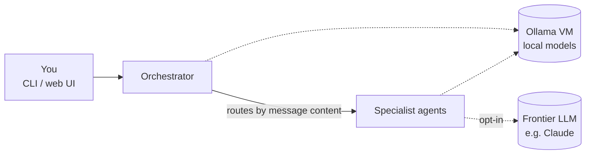

# Sammy

Sammy is a self-hosted household agent. You talk to a single **orchestrator**, which reads each request and passes it to the specialist agent best placed to handle it. By default every agent uses **local models served by Ollama**, so household data stays on the home network. An agent can **opt in** to a cloud frontier model such as Claude when a task needs more capability than the local models offer.

> **Status:** early scaffolding. The workspace, test tooling and conventions are in place. No agents are built yet.

## What Sammy is for

Sammy is meant to help with the running of the household: things like reviewing code in local projects, keeping an eye on the home network, keeping the household calendar up to date and notifying people when something needs attention. Each of these will be its own agent behind the orchestrator, added one at a time.

## Agents

Only agents that have been built are listed here.

| Agent | What it does |
|---|---|
| *(none yet; the orchestrator is first)* | |

## How it works



- **LLM-based routing.** The orchestrator gives a local model the user's message and a registry of available agents (name plus description), and asks it to pick one. There are no hand-written keyword rules, so adding an agent means registering it, not editing routing logic.
- **One model interface, many backends.** Agents depend on a small `ModelClient` protocol, not on a specific provider. Ollama is the default implementation. A frontier-model client (for example Anthropic's API) implements the same protocol, so switching an agent to the cloud is a configuration change, not a code change.
- **Model per agent.** Each agent chooses its own model through configuration. For example, a small, fast model can handle routing while a larger one handles heavier tasks.
- **Local by default.** Cloud models are never used implicitly. An agent uses one only when it is explicitly configured to and an API key is present.
- **Monolith first.** Agents are Python packages imported by whichever process runs them (a CLI now, the web backend later), not separately deployed services. They will be split out only when something concrete requires it.

## Infrastructure

Sammy runs on a home Proxmox host, alongside the services it depends on:

| VM | Role |
|---|---|
| **Ollama** | Serves the local models. Every local-model agent calls it over the LAN. |
| **Sammy** | Runs the orchestrator, the agents and (eventually) the web UI. |

## Repository layout

This is a [uv](https://docs.astral.sh/uv/) workspace with a single shared lockfile and virtual environment at the root.

```
agent/<name>/         one package per agent (orchestrator-agent first)
  tests/              that agent's unit tests
web/                  from-scratch web UI and server (later)
tests/acceptance/
  features/           Gherkin .feature files, written in natural language
  steps/              pytest-bdd step definitions
  drivers/            test doubles and the driver the tests talk to Sammy through
tools/                repo tooling (e.g. creating issues from feature files)
  tests/              unit tests for the tooling
.githooks/            git hooks (pre-commit blocks commits on master)
cosmic-ray.toml       mutation-testing config
CLAUDE.md             build conventions (ATDD workflow, testing rules)
```

## Getting started

Requirements: Python 3.14+ and [uv](https://docs.astral.sh/uv/).

```sh
git config core.hooksPath .githooks   # once per clone: blocks commits on master
uv sync                        # create .venv and install the workspace plus dev tools
uv run pytest                  # run all tests
uv run pytest tests/acceptance # acceptance tests only
uv run pytest agent            # agent unit tests only
uv run pytest tools            # tooling tests only
```

To add a new agent, run from the repo root:

```sh
uv init --package agent/<name>   # registers it as a workspace member
uv sync
```

## Development approach

Sammy is built **acceptance-test first**. Every behaviour starts as a Given/When/Then scenario written in natural language, not in terms of the code. The scenario must fail first, and is then made to pass with the smallest reasonable change. LLM calls are faked at the `ModelClient` boundary, so the suite is fast and deterministic and doesn't need the Ollama VM running.

Each agent also has its own unit tests, kept separate from the acceptance tests.

**Mutation testing** with [cosmic-ray](https://github.com/sixty-north/cosmic-ray) checks that the acceptance scenarios actually pin the behaviour down. A surviving mutant is treated as a missing scenario.

The full rules and commands are in [CLAUDE.md](CLAUDE.md).
